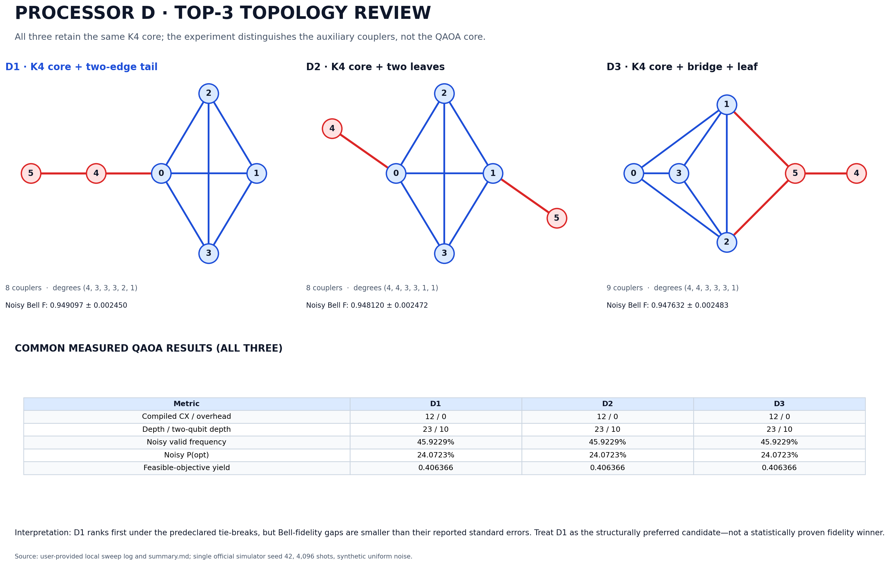
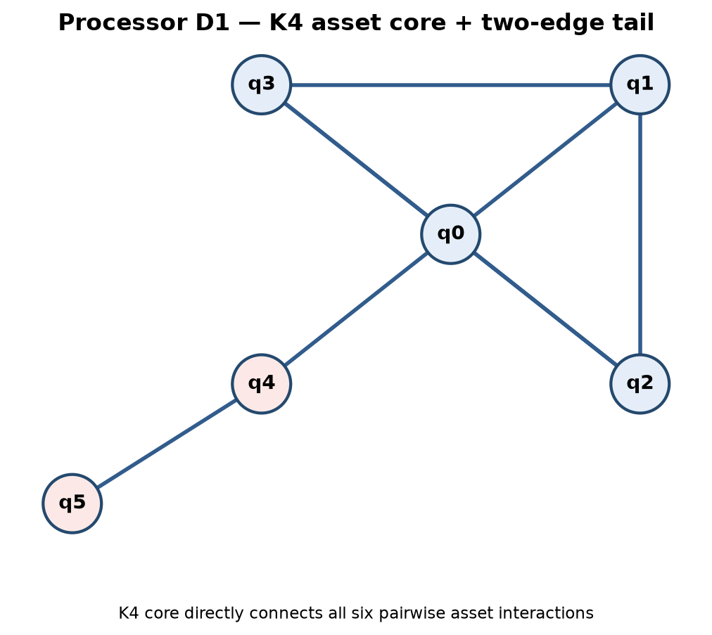

<div align="center">

<table align="center" border="0" cellpadding="6">
  <tr>
    <td align="center" valign="middle" bgcolor="#F5F1E2">
      
    </td>
    <td align="center" valign="middle" bgcolor="#F5F1E2">
      
    </td>
  </tr>
</table>

<p><sub>QFF SRM AP 2026 · QUANTUM OPTIMIZATION</sub></p>
<h1>Portfolio Optimization with QAOA</h1>
<h3>PS-O2 · Phase 2 Benchmark</h3>
<h2>✦ C O U G H I N G &nbsp; B A B Y ✦</h2>
<p><sub>TEAM PROJECT · SRM UNIVERSITY-AP × VIT-AP</sub></p>
<p>
  
  
  
  
</p>
<p></p>
<p><sub>Measured candidate sweep · K4 asset core · selected six-qubit D1 architecture</sub></p>

</div>

---

## At a glance

| Item | Final result |
|---|---|
| Exact classical optimum | **$F^*=4.75$** · bitstring `1100` · assets 0 and 1 |
| D1 compiled resources | **12 CX · depth 23 · 0 SWAPs** |
| Noisy valid-portfolio frequency | A: 44.87% · B: 45.56% · D1: **45.92%** |
| Noisy optimal-portfolio probability | A: 24.39% · B: **24.61%** · D1: 24.07% |
| Experimental protocol | $p=1$ QAOA · 4,096 shots · five optimization starts |
| Scientific scope | Synthetic-noise simulation; no quantum-advantage claim |

This is a small, controlled optimization study. Four binary decision variables produce only 16 bitstrings, so exact classical enumeration is the ground-truth reference. The strongest measured result for D1 is its compiled-resource reduction, not a universal improvement in every solution-quality metric.

## Key results

<!-- BEGIN GENERATED RESULTS -->

### Reference penalty (λ = 2)

| Processor | Condition | Selected | F(x) | F/F* | Valid | P(opt) | CX | Depth | SWAPs |
| --- | --- | --- | --- | --- | --- | --- | --- | --- | --- |
| Processor A | ideal | 1100 | 4.75 | 1.000 | 46.73% | 27.39% | 18 | 42 | 2 |
| Processor A | noisy | 1100 | 4.75 | 1.000 | 44.87% | 24.39% | 18 | 42 | 2 |
| Processor B | ideal | 1100 | 4.75 | 1.000 | 47.39% | 27.34% | 15 | 34 | 1 |
| Processor B | noisy | 1100 | 4.75 | 1.000 | 45.56% | 24.61% | 15 | 34 | 1 |
| Processor D | ideal | 1100 | 4.75 | 1.000 | 46.75% | 25.90% | 12 | 23 | 0 |
| Processor D | noisy | 1100 | 4.75 | 1.000 | 45.92% | 24.07% | 12 | 23 | 0 |

### Selected Processor D

- **Architecture:** D1, six-qubit K4 core plus two-edge tail; eight couplers.
- **Noisy valid-solution frequency:** 45.9229%.
- **Noisy optimal-portfolio probability:** 24.0723%.
- **Compiled CX / depth / SWAPs:** 12 / 23 / 0.
- Processor D is selected based on the measured three-candidate sweep and the stated deterministic ranking rule. The small Bell-fidelity differences are not treated as statistically significant.

<!-- END GENERATED RESULTS -->

## Problem formulation

The locked instance selects exactly $k=2$ of four binary asset variables. The expected-return vector is $\mu=[5,3,4,2]$, the risk-aversion coefficient is $q=0.5$, and the symmetric risk matrix $\Sigma$ comes from `data/instances.json`.

The objective to maximize is

$$
F(x)=\mu^{\mathsf T}x-qx^{\mathsf T}\Sigma x,
\qquad x_i\in\{0,1\},
\qquad \sum_{i=0}^{3}x_i=2.
$$

The constrained problem is encoded as a QUBO by minimizing

$$
E_\lambda(x)=-F(x)+\lambda\left(\sum_{i=0}^{3}x_i-2\right)^2.
$$

The reference penalty is $\lambda=2$; the required sensitivity sweep is $\lambda\in\{0,0.5,1,2,5,10\}$. The six feasible portfolios and reference QUBO matrix are included in the full [technical report](report.md) and machine-readable tables.

## Selected architecture: Processor D1



The four logical asset qubits occupy a complete $K_4$ core, giving a direct physical coupling for each of the six pairwise QUBO interactions. The tail `0–4–5` extends the graph diameter to three for the required farthest-pair Bell verification. D1 satisfies the organizer's PS-O2 constraints: six qubits, connected graph, maximum degree four, the required basis-gate set, and the official noise floors.

D1 was selected over D2 (K4 plus two leaves) and D3 (K4 plus bridge and leaf). In the candidate run, all three had the same compiled QAOA resource metrics and portfolio statistics. D1 won the predeclared ranking through the highest *point estimate* for farthest-pair Bell fidelity, while using eight couplers rather than D3's nine. The small Bell differences do not prove a statistically reliable fidelity improvement.


## Reproducible setup

The tested workflow uses Python 3.12 with package versions pinned in `requirements.txt`. From the repository root:

```bash
python3.12 -m venv .venv
source .venv/bin/activate
python -m pip install --upgrade pip
python -m pip install -r requirements.txt
python scripts/validate_final.py
python scripts/validate_markdown_docs.py
python -m pytest -q
```

Run the complete benchmark and refresh the result tables, plots, README result block, and report result block:

```bash
python scripts/run_final_ps_o2.py
```

The notebook equivalent is `main.ipynb`; open it from the repository root and run the cells from top to bottom. The runner checks the organizer file hashes and validates D1 before sampling. It does not edit `qff_phase2.py` or `data/instances.json`.

## Benchmark protocol

| Setting | Value |
|---|---|
| QAOA depth | $p=1$ |
| Basis gates | `rz`, `sx`, `x`, `cx` |
| Transpiler optimization level | 1 |
| Transpiler / simulator seed | 42 / 42 |
| Shots per condition | 4,096 |
| One-qubit depolarizing rate | 0.001 |
| CX depolarizing rate | 0.005 |
| Symmetric readout bit-flip probability | 0.01 |
| Optimizer | COBYLA; seeds 0–4; up to 200 evaluations per start |

At $\lambda=2$, the best exact-statevector angles are reused on A/B/D for the ideal/noisy comparison. For the D sensitivity experiment, the five starts are re-optimized separately for each penalty value, and the selected angles are evaluated in ideal and noisy conditions.

## Output map

**Scorer-facing `results.csv` semantics:** for PS-O2, each row sets `quality_metric` to `valid_solution_frequency` and `quality_value` to that measured frequency, with the matching uniform-random baseline in `random_baseline`. The selected-portfolio objective ratio, its uniform-random mean baseline, and the other baselines are retained in explicit extension columns so the scoring formula does not need to infer them from another table. The first 18 columns preserve the organizer's schema order; `lambda` and the explicit PS-O2 metrics follow them.

| Artifact | Purpose |
|---|---|
| `main.ipynb` | Executed, end-to-end Phase 2 notebook |
| `processors/processor_D.json` | Selected D1 K4-tail graph |
| `results/tables/results.csv` | Organizer-schema processor rows and D penalty rows |
| `results/tables/bell.csv` | Adjacent/farthest D Bell results, ideal/noisy |
| `results/tables/processor_conditions.csv` | Portfolio metrics at reference $\lambda=2$ |
| `results/tables/processor_resources.csv` | Compiled A/B/D resource metrics |
| `results/tables/processor_d_lambda_sweep.csv` | D penalty sensitivity |
| `results/tables/lambda_optimization_trials.csv` | Five optimization starts per penalty |
| `results/tables/classical_solutions.csv` | Exact feasible portfolios and objective values |
| `results/tables/qubo_matrix_lambda_2.csv` | Reference-penalty QUBO matrix |
| `results/figures/` | Processor, topology and penalty figures |
| `report.md` | Full technical report, results and limitations |

## Interpretation and limitations

- **Finite shots:** small differences at 4,096 shots should not be overinterpreted.
- **Synthetic noise:** the uniform noise model does not include device-specific calibration, crosstalk, or drift.
- **Small instance:** all 16 bitstrings are exactly enumerable; no quantum-advantage claim is made.
- **Architecture comparison:** the K4 core reduces measured routing overhead but does not guarantee higher $P_{\mathrm{opt}}$ on every run or real device.

## AI-use disclosure

AI assistance was used for architecture search and ranking, mathematical review, code and notebook drafting, documentation, and test design. The team is responsible for reviewing the implementation, validating the outputs, and ensuring the report matches the generated artifacts.

---

<div align="center">
  <h2>✦ C O U G H I N G &nbsp; B A B Y ✦</h2>
  <p><sub>QFF SRM AP 2026 · QUANTUM OPTIMIZATION · PS-O2</sub></p>
  <p><sub>Built by Team Coughing Baby · SRM University-AP × VIT University-AP</sub></p>
</div>
