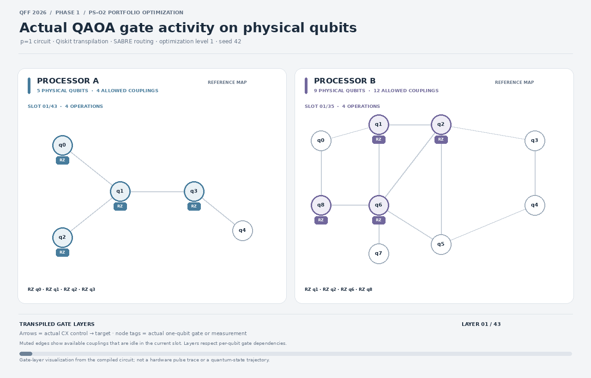

<h1>QFF SRM AP 2026 · PS-O2</h1>

<strong>Constraint-Aware Portfolio Optimization with QAOA</strong>

<strong>Team Coughing Baby</strong>

  
  
  
  

<strong>Track:</strong> Quantum Optimization &nbsp;·&nbsp; <strong>Problem:</strong> PS-O2 &nbsp;·&nbsp; <strong>Stage:</strong> Phase 1

A reproducible four-asset portfolio benchmark comparing the QAOA circuit compiled for two reference processor architectures, with exact classical validation and ideal/noisy simulation.

---

## At a glance

| Item | Result |
|---|---|
| Exact classical optimum | **Asset 1 + Asset 4** |
| Optimal bitstring | <code>1001</code> (bit order: Asset 4 … Asset 1) |
| Best feasible utility at the current provisional parameters | **0.20** |
| Algorithm | QAOA, depth \(p=1\) |
| Processor comparison | Reference Processor A (5 qubits) vs Processor B (9 qubits) |
| Validation | All 16 possible bitstrings enumerated exactly; QUBO/Ising consistency checks and automated tests |

This is a small, controlled optimization study—not a claim of quantum advantage. Because the four-variable problem has only 16 possible bitstrings, its optimum is accessible by exact classical enumeration.

## Processor gate activity

The animation below is generated from the actual Qiskit-transpiled \(p=1\) circuits. It visualizes the compiled gate schedule on the two reference coupling maps.

<!-- QFF_PROCESSOR_ANIMATION -->

  

Arrows indicate emitted CX control-to-target directions; node tags show emitted single-qubit gates or measurement. This is a dependency-scheduled gate-layer visualization—not a hardware pulse trace or quantum-state trajectory. See <a href="results/tables/processor_gate_schedule.csv">the gate schedule CSV</a> for machine-readable events.

## Baseline results

The same logical QAOA circuit and optimized angles are used for both processor configurations. Each probability below comes from 4,096 simulator shots.

| Processor | Mode | Qubits | Depth | CX gates | SWAP diagnostic* | Valid portfolio | Optimal portfolio |
|---|---|---:|---:|---:|---:|---:|---:|
| A | Ideal | 5 | 43 | 18 | 2 | 53.96% | 14.40% |
| A | Synthetic noise | 5 | 43 | 18 | 2 | 52.66% | 13.38% |
| B | Ideal | 9 | 35 | 15 | 1 | 54.03% | 14.55% |
| B | Synthetic noise | 9 | 35 | 15 | 1 | 52.66% | 14.01% |

*The SWAP diagnostic comes from a separate diagnostic transpilation that retains SWAP operations; it is not the literal SWAP count of the native-basis circuit.

In this instance, Processor B compiles to a shallower circuit with fewer CX gates and has a slightly higher noisy optimal-portfolio probability. The supplementary ten-seed comparison is more cautious: the 95% paired t-intervals for all three reported metrics include zero, so these runs do not establish a statistically clear performance difference.

See [report.md](report.md) for the full results, robustness intervals, sensitivity analyses, and limitations.

## Problem formulation

Each decision variable represents whether an asset is selected:

\[
x_i \in \{0,1\}, \qquad \sum_i x_i = 2
\]

The implemented QUBO objective is

\[
\min_x \quad x^\mathsf{T}\Sigma x - q\,\mu^\mathsf{T}x
+ A\left(\sum_i x_i-2\right)^2
\]

The reported economic utility for feasible portfolios is

\[
U(x)=q\,\mu^\mathsf{T}x-x^\mathsf{T}\Sigma x
\]

The expected-return vector and covariance matrix are transcribed from **QFF SRM APPhase 1 Master Guide.pdf, page 4**. The numeric \(q\) and penalty \(A\) are experiment settings, not official values prescribed by the guide.

## Method

1. **Define the instance.** Load the four-asset returns and covariance matrix and encode the exactly-two-assets constraint.
2. **Validate classically.** Enumerate all 16 bitstrings, compute the feasible optimum, and validate the QUBO/Ising formulation.
3. **Build and compile QAOA.** Run the \(p=1\) circuit against the documented reference coupling maps using Qiskit transpilation.
4. **Simulate ideal and noisy cases.** Record feasibility, optimal-solution probability, utility, depth, CX count, and a separately computed SWAP diagnostic.
5. **Test robustness and sensitivity.** Compare ten fixed simulator seeds for the two reference processors and perform exact classical sensitivity analyses for \(q\) and \(A\).

## Reproducibility

### Environment

Python 3.12 is used in the automated workflow.

    python3 -m venv .venv
    source .venv/bin/activate
    python -m pip install --upgrade pip
    python -m pip install -r requirements.txt

Open [main.ipynb](main.ipynb) from the repository root, select the <code>.venv</code> kernel, review the configuration cell, and run all cells. The notebook is the end-to-end experiment driver; a separate <code>main.py</code> is not required.

### Transpilation and noise settings

| Setting | Value |
|---|---|
| QAOA depth | \(p=1\) |
| Basis gates | <code>rz</code>, <code>sx</code>, <code>x</code>, <code>cx</code> |
| Optimization level | 1 |
| Layout/routing | SABRE |
| Transpiler seed | 42 |
| Shots per baseline run | 4,096 |
| Single-qubit depolarizing error | 0.001 |
| CX depolarizing error | 0.005 |
| Readout error | 0.01, represented as a symmetric bit-flip |

The guide specifies a 1% readout error rate but does not provide a readout confusion matrix. The symmetric bit-flip model is therefore an explicit simulation assumption, not an organizer-supplied calibration.

## Key assumptions and limitations

- **\(q=1.0\) is provisional.** The Master Guide's PS-O2 section does not prescribe a numeric \(q\). The repository includes exact sensitivity analysis over alternative values; organizer confirmation is needed before describing \(q=1.0\) as official.
- **\(A=0.02\) is participant-selected.** Under the current \(q\) and squared-cardinality penalty, exact enumeration gives a strict-feasibility threshold of \(A>0.01\) for this particular instance. This is not a universal or organizer-prescribed threshold.
- **Decision variables are binary.** The model selects exactly two assets; it is not a continuous-weight portfolio allocation.
- **Processor maps are the documented references.** The analysis retains the Master Guide reference Processor A and B topologies and does not include participant-designed alternative-topology experiments.
- **Noise results are simulated.** Aer results are not measurements from quantum hardware. Ten seeds provide a limited simulator robustness check, not evidence of hardware uncertainty or broad generalization.
- **No quantum-advantage claim is made.** Exact enumeration is the appropriate classical reference for this 16-state instance.

## Repository map

| Path | Purpose |
|---|---|
| [main.ipynb](main.ipynb) | End-to-end reproducible benchmark and sensitivity analyses |
| [processors/](processors/) | Processor A and B reference configurations |
| [src/](src/) | Problem formulation, topology handling, routing, metrics, and visualization code |
| [data/](data/) | Raw and processed experiment inputs |
| [results/tables/](results/tables/) | CSV/JSON metrics, solutions, metadata, robustness and gate-schedule exports |
| [results/figures/](results/figures/) | Comparison and sensitivity figures |
| [report.md](report.md) | Full methodology, benchmark results, interpretation, and limitations |
| [tests/](tests/) | Unit and artifact checks |
| [requirements.txt](requirements.txt) | Runtime dependencies |
| [requirements-dev.txt](requirements-dev.txt) | Development and test dependencies |

### Useful result files

- [processor_comparison.csv](results/tables/processor_comparison.csv) — Processor A/B ideal and noisy baseline metrics
- [classical_solutions.json](results/tables/classical_solutions.json) — all bitstrings and exact optimum
- [processor_gate_schedule.csv](results/tables/processor_gate_schedule.csv) — events used in the gate animation
- [paired_robustness_comparison.csv](results/tables/paired_robustness_comparison.csv) — paired ten-seed Processor B minus A comparisons
- [q_sensitivity.csv](results/tables/q_sensitivity.csv) and [penalty_sensitivity.csv](results/tables/penalty_sensitivity.csv) — exact parameter sensitivity tables

---

## Team Coughing Baby

  
  

| Member | Role | Institution |
|---|---|---|
| **Ashwath Raj** | Team Lead |  |
| Jammu Venkata Satyam … | Team Member |  |
| Bhamidimarry Venkata S… | Team Member |  |
| Pagoti Kalyan Vivek | Team Member |  |

Roster status in the supplied screenshot: 4 confirmed members out of a 2–6 member team. Two teammate display names are shown with ellipses because the screenshot truncates them; their full registered names should replace these shortened labels when confirmed.

QFF SRM AP 2026 · Quantum Optimization · PS-O2

