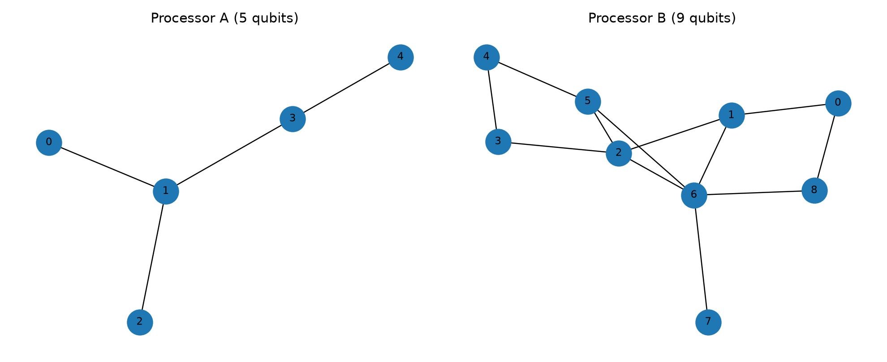
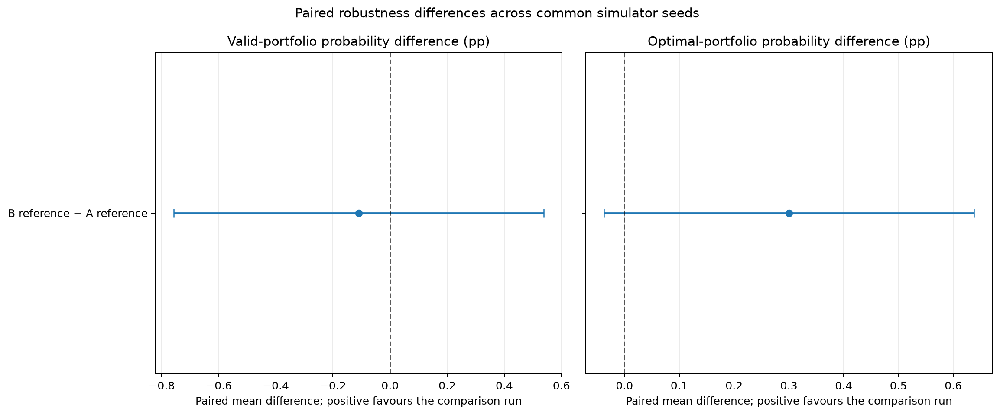
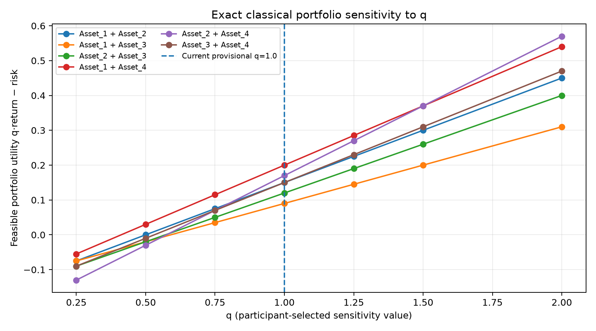
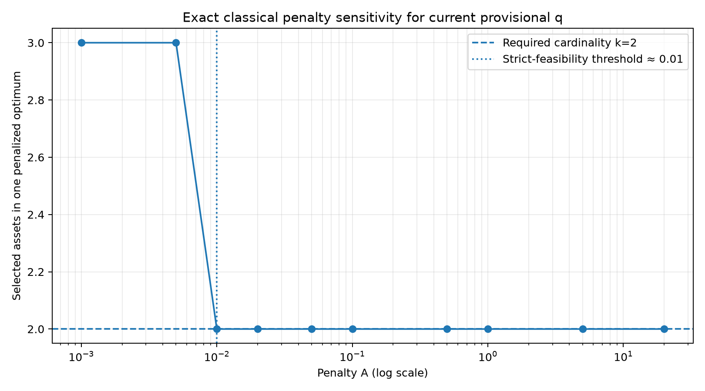

# QFF 2026 Phase 1 — PS-O2 Portfolio Optimization

## Benchmark provenance

- Inputs: QFF Phase 1 Master Guide, page 4.
- Returns μ: `[0.12, 0.18, 0.1, 0.22]`
- Risk matrix minimum eigenvalue: `0.02363584`
- q: `1.0` — participant-selected because the Master Guide's PS-O2 section does not prescribe a numeric value.
- Cardinality: exactly 2 assets.
- Penalty A: `0.02` — participant-selected implementation choice; neither the Master Guide PS-O2 entry nor the organizer clarification prescribes a numeric A.
- Formulation: minimize `x.T @ Sigma @ x - q * mu.T @ x + A * (sum(x)-2)^2`.
- Reported economic objective: `q * mu.T @ x - x.T @ Sigma @ x`, only on feasible portfolios.

## Exact classical reference

- Optimal portfolio: Asset_1, Asset_4
- Bitstring (asset 4 … asset 1): `1001`
- Best feasible unpenalized objective: `0.2000000000`

## Controlled Processor A/B results

| Processor | Mode | Qubits | Depth | CX | SWAP diagnostic | Valid probability | Optimal probability | Mean utility (all samples) | Mean utility (valid only) | Best sampled valid objective | Best-sample ratio | Gap |
|---|---|---:|---:|---:|---:|---:|---:|---:|---:|---:|
| Processor A | ideal | 5 | 43 | 18 | 2 | 0.5396 | 0.1440 | 0.16359619 | 0.15805430 | 0.20000000 | 1.000000 | 0.00000000 |
| Processor A | noisy | 5 | 43 | 18 | 2 | 0.5266 | 0.1338 | 0.16114746 | 0.15665276 | 0.20000000 | 1.000000 | 0.00000000 |
| Processor B | ideal | 9 | 35 | 15 | 1 | 0.5403 | 0.1455 | 0.16387695 | 0.15810212 | 0.20000000 | 1.000000 | 0.00000000 |
| Processor B | noisy | 9 | 35 | 15 | 1 | 0.5266 | 0.1401 | 0.16186768 | 0.15772833 | 0.20000000 | 1.000000 | 0.00000000 |

## Compilation protocol

- QAOA p=1; same logical circuit and optimized angles for both processors.
- Basis gates `{rz, sx, x, cx}`; optimization level 1; SABRE layout/routing; transpiler seed 42; 4096 shots.
- Noise model: one-qubit depolarizing 0.001; CX depolarizing 0.005. The guide only gives a 1% readout error rate, not a confusion matrix; this implementation models it as symmetric 1% bit-flip and records that assumption. Ideal and noisy runs are reported separately.
- SWAP count comes from a separate diagnostic transpilation with SWAP retained; it is not the native-basis circuit's literal SWAP count.

## Interpretation and limitations

- Four assets yield only 16 bitstrings and can be solved exactly classically; no quantum advantage is claimed.
- The best-sampled objective ratio equals 1 when at least one sample reaches the exact optimum; interpret it alongside optimal-portfolio probability, not as an average-quality or success-probability metric.
- The numeric q is not specified in the Master Guide and was selected provisionally for this run; obtain organizer confirmation before treating it as official.
- Penalty A is participant-selected and documented, not organizer-prescribed; exact enumeration validates the selected value for this instance and current q.
- Decision variables: the organizer clarified that x_i are binary selection indicators in {0,1}, with exactly k=2 selected assets. A continuous-weight allocation is a different model and is not used here.
- Coupling graphs are reference architectures. The included A/B runs use the documented reference edges; any participant-designed topology must be reported separately.
- The synthetic noise results are Aer simulation measurements, not hardware measurements.
- Generative AI assisted code drafting/review and documentation organization; the participant remains responsible for checking every assumption and result, subject to the event AI-use policy.

## Reproducibility

Run every code cell in `main.ipynb` from the repository root after setting `Q` in the configuration cell. Tables are regenerated under `results/tables/`, figures under `results/figures/`, and the report at `report.md`.

## Supplementary experiments: reference robustness and parameter sensitivity

The four Processor A/B × ideal/noisy rows above remain the required Master Guide reference baseline. The supplementary robustness experiment uses the same two reference coupling maps and ten simulator seeds per processor; it does not include participant-designed alternative topologies.

### Reference topology and compiled-resource comparison

| Processor | Topology | Mode | Edges | Diameter | Avg. shortest path | Depth | CX | SWAP diagnostic | Valid probability | Optimal probability |
|---|---|---|---:|---:|---:|---:|---:|---:|---:|---:|
| Processor A | Master Guide reference | ideal | 4 | 3 | 1.800 | 43 | 18 | 2 | 0.5396 | 0.1440 |
| Processor A | Master Guide reference | noisy | 4 | 3 | 1.800 | 43 | 18 | 2 | 0.5266 | 0.1338 |
| Processor B | Master Guide reference | ideal | 12 | 4 | 1.944 | 35 | 15 | 1 | 0.5403 | 0.1455 |
| Processor B | Master Guide reference | noisy | 12 | 4 | 1.944 | 35 | 15 | 1 | 0.5266 | 0.1401 |

### Noisy-seed robustness

These summaries use simulator seeds (7, 21, 42, 84, 126, 168, 210, 252, 294, 336), with 4096 shots per run. Intervals describe this simulator experiment, not hardware uncertainty.

| Processor | Seeds | Mean valid probability | SD across seeds | 95% t interval (valid probability) | Mean optimal probability | SD across seeds |
|---|---:|---:|---:|---:|---:|---:|
| Processor A | 10 | 0.5218 | 0.0081 | [0.5160, 0.5276] | 0.1299 | 0.0046 |
| Processor B | 10 | 0.5207 | 0.0068 | [0.5158, 0.5256] | 0.1329 | 0.0042 |

### Paired robustness comparisons between reference processors

Each difference is Processor B minus Processor A, paired by the same ten simulator seeds. The 95% paired t intervals are exploratory simulator intervals, not hardware uncertainty intervals.

| Comparison | Metric | Mean paired difference (95% CI) | Seed pairs |
|---|---|---:|---:|
| Processor B reference minus Processor A reference | Valid-portfolio probability | -0.11 pp [-0.76, +0.54] | 10 |
| Processor B reference minus Processor A reference | Optimal-portfolio probability | +0.30 pp [-0.04, +0.64] | 10 |
| Processor B reference minus Processor A reference | Mean utility among valid samples | +0.00032 [-0.00051, +0.00115] | 10 |

### Findings and architecture interpretation

For this p=1 instance and these transpiler settings, reference Processor B compiles to depth 35 with 15 CX gates and 1 diagnostic SWAP, versus depth 43, 18 CX gates, and 2 diagnostic SWAPs for reference Processor A.

All three paired-seed 95% t intervals for the reference A/B comparison include zero. Across ten fixed simulator seeds, these results do not establish a statistically clear performance difference. These findings are limited to this circuit, parameter choice, simulator noise model, and seed set.

### Exact sensitivity to the unspecified q

The Master Guide does not prescribe q. The following is a participant-created exact classical sensitivity analysis, not an inferred official value.

| q | Exact optimal feasible portfolio(s) | Best feasible utility |
|---:|---|---:|
| 0.25 | Asset_1 + Asset_4 | -0.055000 |
| 0.50 | Asset_1 + Asset_4 | 0.030000 |
| 0.75 | Asset_1 + Asset_4 | 0.115000 |
| 1.00 | Asset_1 + Asset_4 | 0.200000 |
| 1.25 | Asset_1 + Asset_4 | 0.285000 |
| 1.50 | Asset_1 + Asset_4; Asset_2 + Asset_4 | 0.370000 |
| 2.00 | Asset_2 + Asset_4 | 0.570000 |

### Exact sensitivity to the cardinality penalty A

For the current provisional q=1, exact enumeration gives a strict-feasibility threshold A > 0.01 for this four-asset instance under the implemented squared-cardinality penalty. This threshold is instance- and q-specific; it is not an organizer-prescribed value for A.

| A | One optimal bitstring | Selected count | Feasible? | Infeasible optimum tie? |
|---:|---|---:|---|---|
| 0.001 | 1011 | 3 | no / tie | yes |
| 0.005 | 1011 | 3 | no / tie | yes |
| 0.01 | 1001 | 2 | no / tie | yes |
| 0.02 | 1001 | 2 | yes | no |
| 0.05 | 1001 | 2 | yes | no |
| 0.1 | 1001 | 2 | yes | no |
| 0.5 | 1001 | 2 | yes | no |
| 1 | 1001 | 2 | yes | no |
| 5 | 1001 | 2 | yes | no |
| 20 | 1001 | 2 | yes | no |

### Reproducibility and limitations

- Only the documented Master Guide reference coupling graphs are used; no participant-designed alternative-topology experiment is included.
- Ten seeds provide a supplementary simulator robustness check, not hardware-level confidence or generalization to other circuits.
- q remains provisional pending organizer confirmation; A is a participant-selected and documented penalty, not an organizer-prescribed value.
- These are simulator results for a four-variable, 16-state problem. No quantum-advantage claim is made.
- Generative AI assisted with code drafting/review and documentation organization; the participant is responsible for verifying the final code and claims, subject to the event policy.
