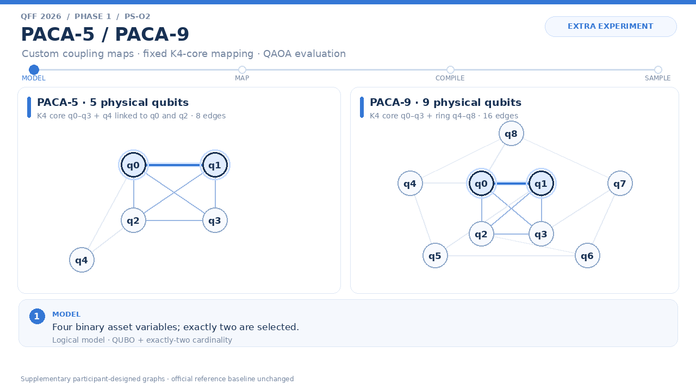

# QFF 2026 Phase 1 — PS-O2 Portfolio Optimization

## Benchmark provenance and current assumptions

- Source of the portfolio instance: QFF Phase 1 Master Guide, page 4.
- Expected-return vector: \(\mu=[0.12,\;0.18,\;0.10,\;0.22]^{\mathsf T}\).
- Risk/covariance matrix minimum eigenvalue: approximately `0.02363584`.
- Decision variables are binary selection indicators: \(x_i\in\{0,1\}\), with exactly \(k=2\) of the four assets selected. The organizer clarified that the \(x_i\) are binary selection indicators; the project does not model continuous portfolio weights.
- The Master Guide does not prescribe a numeric value for \(q\). This run uses participant-selected \(q=1.0\). The value q remains provisional pending organizer confirmation.
- The cardinality penalty \(A=0.02\) is also participant-selected, not organizer-prescribed.
- The official reference files `processors/processor_A.json` and `processors/processor_B.json` remain unchanged. PACA-5 and PACA-9 are separately labelled participant-designed supplementary topologies.

## Mathematical formulation

Let \(x_i\in\{0,1\}\) denote whether asset \(i\) is selected: \(x_i=1\) indicates selection and \(x_i=0\) indicates exclusion. The problem requires selecting exactly two of the four assets:

$$
x_i\in\{0,1\},\quad i=1,\ldots,4,\qquad
\sum_{i=1}^{4}x_i=2.
$$

The binary decision variables are encoded as a Quadratic Unconstrained Binary Optimization (QUBO) problem by incorporating the cardinality constraint into the objective as a squared penalty:

$$
\boxed{
\min_{x\in\{0,1\}^{4}}
\left[
x^{\mathsf T}\Sigma x
-q\,\mu^{\mathsf T}x
+A\left(\sum_{i=1}^{4}x_i-2\right)^2
\right]
}
$$

Here, \(\mu\) is the expected-return vector, \(\Sigma\) is the risk/covariance matrix, \(q\) scales the contribution of expected return relative to risk, and \(A\) penalizes solutions that violate the requirement to select exactly two assets. The formulation therefore remains a **binary asset-selection problem**, rather than a continuous portfolio-weight optimization problem.

The instance uses the following input data:

$$
\mu=
\begin{bmatrix}
0.12&0.18&0.10&0.22
\end{bmatrix}^{\mathsf T},
\qquad
\Sigma=
\begin{bmatrix}
0.04&0.01&0.02&0.01\\
0.01&0.09&0.01&0.03\\
0.02&0.01&0.05&0.02\\
0.01&0.03&0.02&0.08
\end{bmatrix}.
$$

The experiment uses \(q=1.0\) and \(A=0.02\). These are **participant-selected experimental parameters**, not values prescribed by the QFF Master Guide. The guide does not specify a numerical value for \(q\) or a mandatory method for choosing the penalty strength \(A\).

For this instance, exact classical enumeration shows that \(A>0.01\) is required for the minimum-cost QUBO state to be strictly feasible under the implemented squared-cardinality penalty. At \(A=0.01\), a feasible and an infeasible state tie for the minimum; the selected value \(A=0.02\) clears this threshold. This is an instance-specific feasibility justification, not a claim that \(A=0.02\) is the universally optimal penalty or QAOA parameter.

For evaluating sampled bitstrings, the implementation also calculates the unpenalized score

$$
U(x)=q\,\mu^{\mathsf T}x-x^{\mathsf T}\Sigma x.
$$

For feasible bitstrings satisfying \(\sum_i x_i=2\), this score represents the objective's return-minus-risk utility under the selected \(q\). For infeasible bitstrings, it is reported only as a diagnostic value; feasibility is assessed separately by checking the cardinality constraint. This distinction prevents a high unpenalized score from being mistaken for a valid portfolio.
## Exact classical reference

Exact enumeration of all \(2^4=16\) bitstrings identifies **Asset 1 + Asset 4** as the best feasible portfolio at the current provisional settings. With the report's bit order of Asset 4 through Asset 1, the bitstring is `1001`, and the feasible utility is `0.20`. Since the state space contains only 16 bitstrings, this is a classical exact benchmark, not evidence of quantum advantage.

## Controlled Processor A/B results

These four rows are the required Master Guide reference baseline. All probabilities below are fractions from 4,096 simulator shots. The SWAP diagnostic is obtained from a separate diagnostic transpilation that retains SWAP gates; it is not the literal SWAP count of the native-basis circuit, whose native SWAP count is zero.

### Compiled circuit resources

| Processor | Mode | Qubits | Depth | CX gates | SWAP diagnostic |
|---|---|---:|---:|---:|---:|
| Processor A | Ideal | 5 | 43 | 18 | 2 |
| Processor A | Noisy | 5 | 43 | 18 | 2 |
| Processor B | Ideal | 9 | 35 | 15 | 1 |
| Processor B | Noisy | 9 | 35 | 15 | 1 |

### Portfolio sampling probabilities

| Processor | Mode | Valid-portfolio probability | Optimal-portfolio probability |
|---|---|---:|---:|
| Processor A | Ideal | 0.5396 | 0.1440 |
| Processor A | Noisy | 0.5266 | 0.1338 |
| Processor B | Ideal | 0.5403 | 0.1455 |
| Processor B | Noisy | 0.5266 | 0.1401 |

### Sampled utility and best-sample gap

| Processor | Mode | Mean utility, all samples* | Mean utility, valid samples | Best sampled valid utility | Best-sample ratio | Optimality gap |
|---|---|---:|---:|---:|---:|---:|
| Processor A | Ideal | 0.16359619 | 0.15805430 | 0.20000000 | 1.000000 | 0.00000000 |
| Processor A | Noisy | 0.16114746 | 0.15665276 | 0.20000000 | 1.000000 | 0.00000000 |
| Processor B | Ideal | 0.16387695 | 0.15810212 | 0.20000000 | 1.000000 | 0.00000000 |
| Processor B | Noisy | 0.16186768 | 0.15772833 | 0.20000000 | 1.000000 | 0.00000000 |

*The all-sample mean includes infeasible bitstrings and is reported as a diagnostic score. The valid-sample mean includes only bitstrings selecting exactly two assets. The best-sample ratio is 1 because each run sampled the exact best feasible state at least once; it is not an estimate of the probability of finding that state.

## Findings and architecture interpretation

For this p=1 instance and the stated transpiler configuration, reference Processor B compiles to depth 35 with 15 CX gates and one diagnostic SWAP, compared with depth 43, 18 CX gates, and two diagnostic SWAPs for reference Processor A. The ten-seed paired robustness comparisons report that all three paired-seed 95% t intervals include zero; they do not establish a statistically clear performance difference between the reference processors.

The supplementary PACA graphs compile to depth 24 and 12 CX gates in the recorded automatic/fixed layout runs, but lower compiled resource counts do not guarantee a higher optimal-portfolio sampling probability. In the seed-42 noisy runs, PACA-5 with fixed K4 placement sampled the optimum at 13.75% versus 13.11% with automatic SABRE, while PACA-9 produced 13.75% with either layout. These are finite-shot observations from the stated synthetic-noise simulator, not statistically established layout gains or hardware results.

## Supplementary experiment: topology, robustness, and parameter sensitivity

This section describes **additional participant-designed experiments**. They do not replace or alter the required Master Guide Processor A/B baseline. The topology and layout experiments use the same logical \(p=1\) QAOA parameters and compare ideal and noisy simulation separately.

Workflow schematic: model → map → compile → sample. The animation is not a quantum-state trajectory and does not display individual measurement shots.

### Custom graph design and structural metrics

| Graph | Physical qubits | Edges | Construction | Diameter | Average shortest path |
|---|---:|---:|---|---:|---:|
| Reference A | 5 | 4 | Master Guide reference graph | 3 | 1.800 |
| PACA-5 | 5 | 8 | K4 core on physical qubits q0–q3; peripheral q4 linked to q0 and q2 | 2 | 1.200 |
| Reference B | 9 | 12 | Master Guide reference graph | 4 | 1.944 |
| PACA-9 | 9 | 16 | K4 core on q0–q3; ring q4–q5–q6–q7–q8–q4; five links between core and ring | 2 | 1.556 |

The four-variable QUBO has pairwise interactions among every pair of logical variables. A K4 physical subgraph therefore provides direct physical connectivity among four placed logical qubits. This motivates the design but does not imply that extra edges improve solution quality. In PACA-5, the two peripheral links are q0–q4 and q2–q4. In PACA-9, the ring has five edges and the core-to-ring links are q0–q4, q1–q5, q2–q6, q3–q7, and q0–q8.

### Noisy automatic-versus-fixed K4 layout comparison

The automatic configuration lets SABRE choose the layout. The fixed-K4 configuration explicitly sets `initial_layout=[0, 1, 2, 3]`, mapping logical input qubits 0–3 to physical qubits q0–q3. Both use the same logical circuit and parameters, optimization level 1, basis gates `{rz, sx, x, cx}`, transpiler seed 42, 4,096 shots, and the documented synthetic noise model.

#### Compiled resources

| Custom topology | Layout strategy | Mode | Physical qubits | Edges | Depth | CX gates |
|---|---|---|---:|---:|---:|---:|
| PACA-5 | Automatic SABRE | Ideal | 5 | 8 | 24 | 12 |
| PACA-5 | Fixed K4 core | Ideal | 5 | 8 | 24 | 12 |
| PACA-5 | Automatic SABRE | Noisy | 5 | 8 | 24 | 12 |
| PACA-5 | Fixed K4 core | Noisy | 5 | 8 | 24 | 12 |
| PACA-9 | Automatic SABRE | Ideal | 9 | 16 | 24 | 12 |
| PACA-9 | Fixed K4 core | Ideal | 9 | 16 | 24 | 12 |
| PACA-9 | Automatic SABRE | Noisy | 9 | 16 | 24 | 12 |
| PACA-9 | Fixed K4 core | Noisy | 9 | 16 | 24 | 12 |

#### Sampling results

| Custom topology | Layout strategy | Mode | Valid-portfolio probability | Optimal-portfolio probability |
|---|---|---|---:|---:|
| PACA-5 | Automatic SABRE | Ideal | 54.05% | 13.87% |
| PACA-5 | Fixed K4 core | Ideal | 54.42% | 14.26% |
| PACA-5 | Automatic SABRE | Noisy | 52.69% | 13.11% |
| PACA-5 | Fixed K4 core | Noisy | 53.49% | 13.75% |
| PACA-9 | Automatic SABRE | Ideal | 54.42% | 14.26% |
| PACA-9 | Fixed K4 core | Ideal | 54.42% | 14.26% |
| PACA-9 | Automatic SABRE | Noisy | 53.49% | 13.75% |
| PACA-9 | Fixed K4 core | Noisy | 53.49% | 13.75% |

The seed-42 noisy run shows PACA-5's observed optimal-portfolio probability moving from 13.11% with automatic SABRE to 13.75% with fixed K4 placement, a difference of about +0.64 percentage points. PACA-9 records 13.75% with either layout in this run. All eight recorded custom topology/layout/mode combinations compile to depth 24 and 12 CX gates in these runs.

These are single-seed, finite-shot observations. The difference in sampled percentages is not evidence of statistically significant improvement, and the equality in depth/CX means the fixed-layout experiment did not reduce those compiled-resource counts relative to automatic layout in the recorded runs. The extra PACA edges define the graph but do not by themselves establish that peripheral edges are exercised by this four-logical-qubit circuit. The results are simulation measurements, not hardware results.

Machine-readable artifacts: [`topology_experiment.csv`](results/tables/topology_experiment.csv), [`paca_layout_comparison.csv`](results/tables/paca_layout_comparison.csv), and [`topology_experiment_metadata.json`](results/tables/topology_experiment_metadata.json). The companion figure is [`paca_layout_comparison.png`](results/figures/paca_layout_comparison.png).

### Ten-seed noisy robustness across reference and custom graphs

The robustness artifact contains 40 trials: ten simulator seeds (`7, 21, 42, 84, 126, 168, 210, 252, 294, 336`) for Reference A, PACA-5 with automatic SABRE layout, Reference B, and PACA-9 with automatic SABRE layout. It does **not** provide a ten-seed robustness study of the fixed-K4 layout; that mapping comparison above uses seed 42. Each trial uses 4,096 shots. The intervals below are exploratory t intervals across simulator seeds, not hardware confidence intervals.

#### Valid-portfolio probability

| Configuration | Mean | Sample SD | 95% t interval |
|---|---:|---:|---:|
| Reference A | 52.18% | 0.81 pp | [51.60%, 52.76%] |
| PACA-5, automatic SABRE | 52.09% | 0.84 pp | [51.50%, 52.69%] |
| Reference B | 52.07% | 0.68 pp | [51.58%, 52.56%] |
| PACA-9, automatic SABRE | 52.67% | 0.71 pp | [52.17%, 53.18%] |

#### Optimal-portfolio probability

| Configuration | Mean | Sample SD | 95% t interval |
|---|---:|---:|---:|
| Reference A | 12.99% | 0.46 pp | [12.66%, 13.32%] |
| PACA-5, automatic SABRE | 13.27% | 0.48 pp | [12.93%, 13.61%] |
| Reference B | 13.29% | 0.42 pp | [12.99%, 13.59%] |
| PACA-9, automatic SABRE | 13.69% | 0.41 pp | [13.40%, 13.98%] |

### Paired robustness comparisons: reference Processor B minus Processor A

The paired comparison uses the same ten simulator seeds for both reference graphs. All three paired-seed 95% t intervals include zero; these comparisons do not establish a statistically clear performance difference between the reference processors.

| Metric | Mean paired difference | 95% paired t interval | Seed pairs |
|---|---:|---:|---:|
| Valid-portfolio probability | -0.11 pp | [-0.76, +0.54] pp | 10 |
| Optimal-portfolio probability | +0.30 pp | [-0.04, +0.64] pp | 10 |
| Mean utility among valid samples | +0.000317 | [-0.000515, +0.001150] | 10 |

### Paired-comparison interpretation

For the reference-only paired comparison, the means and intervals below describe variation across the same ten simulator seeds on A and B. The resource-cost difference does not by itself establish a solution-quality advantage.

Artifact: [`paired_robustness_comparison.csv`](results/tables/paired_robustness_comparison.csv). Figure: [`paired_robustness_differences.png`](results/figures/paired_robustness_differences.png).

### Exact sensitivity to the unspecified q

The Master Guide does not prescribe a numeric \(q\). The values below are a participant-created exact classical sensitivity analysis—not an inferred official value.

| q | Exact optimal feasible portfolio(s) | Best feasible utility |
|---:|---|---:|
| 0.25 | Asset 1 + Asset 4 | -0.055000 |
| 0.50 | Asset 1 + Asset 4 | 0.030000 |
| 0.75 | Asset 1 + Asset 4 | 0.115000 |
| 1.00 | Asset 1 + Asset 4 | 0.200000 |
| 1.25 | Asset 1 + Asset 4 | 0.285000 |
| 1.50 | Asset 1 + Asset 4; Asset 2 + Asset 4 (tie) | 0.370000 |
| 2.00 | Asset 2 + Asset 4 | 0.570000 |

Figure: [`q_sensitivity.png`](results/figures/q_sensitivity.png). Table: [`q_sensitivity.csv`](results/tables/q_sensitivity.csv).

### Exact sensitivity to the cardinality penalty A

For the current provisional \(q=1.0\), exact enumeration gives a strict-feasibility condition of \(A>0.01\) for this instance and the implemented squared-cardinality penalty. At exactly \(A=0.01\), a feasible state and an infeasible state tie for the minimum; the strict inequality is intentional. This is not an organizer-prescribed value or a universal threshold.

| Penalty A | Optimal bitstring(s) | Selected count(s) | Cardinality interpretation |
|---:|---|---:|---|
| 0.001 | `1011` | 3 | Best state is infeasible |
| 0.005 | `1011` | 3 | Best state is infeasible |
| 0.01 | `1001`, `1011` (tie) | 2, 3 | Feasible and infeasible states tie |
| 0.02 | `1001` | 2 | All minimum-cost states are feasible |
| 0.05 | `1001` | 2 | All minimum-cost states are feasible |
| 0.1 | `1001` | 2 | All minimum-cost states are feasible |
| 0.5 | `1001` | 2 | All minimum-cost states are feasible |
| 1.0 | `1001` | 2 | All minimum-cost states are feasible |
| 5.0 | `1001` | 2 | All minimum-cost states are feasible |
| 20.0 | `1001` | 2 | All minimum-cost states are feasible |

Figure: [`penalty_sensitivity.png`](results/figures/penalty_sensitivity.png). Table: [`penalty_sensitivity.csv`](results/tables/penalty_sensitivity.csv).

## Compilation protocol and noise assumptions

- QAOA depth: \(p=1\); the logical QAOA parameters are shared across the compared processor/layout runs (`gamma ≈ 0.43801688`, `beta ≈ 2.76843709`).
- Basis gates: `{rz, sx, x, cx}`; optimization level 1; SABRE layout/routing for automatic runs; transpiler seed 42; 4,096 shots per seed/configuration.
- Synthetic noise: single-qubit depolarizing rate `0.001`, CX depolarizing rate `0.005`, and readout error rate `0.01` modeled as an independent symmetric bit-flip. The Master Guide gives the readout error rate but not a confusion matrix, so the symmetric bit-flip channel is an explicit simulation assumption.
- The circuit's native-basis compilation reports zero native SWAP gates; the separately reported SWAP diagnostic comes from a diagnostic transpilation that retains SWAP gates.

## Interpretation and limitations

- The problem has only 16 states and is solved exactly classically. No quantum-advantage claim is made.
- \(q=1.0\) remains provisional because the Master Guide does not prescribe a numerical value. Confirm it with the organizer before treating it as official.
- \(A=0.02\) is participant-selected. Its feasibility threshold is exact for this four-asset instance and current \(q\), not a general rule.
- PACA-5 and PACA-9 are custom participant-designed supplementary graphs, not official reference processor configurations. Their results are kept separate from the required reference baseline.
- Single-seed layout results can show observed shot-count differences but cannot establish a statistically significant layout benefit. Ten-seed robustness covers automatic-SABRE layouts for reference A, PACA-5, reference B, and PACA-9; it does not cover fixed-K4 layouts across ten seeds.
- Aer results are simulator outputs, not hardware measurements. The noise model is synthetic, and conclusions are limited to this circuit, parameter choice, transpiler configuration, and seed set.

## Proposed Processor D — design concept only

**Status:** conceptual proposal only. Processor D was not implemented, executed,
or evaluated in Phase 1. The measured results remain the reference Processor A/B
runs and the separately labelled supplementary topology experiments.

A candidate starting point for a future custom Processor D is a fully connected
four-qubit core (the six pairwise edges of a K4 graph). This can directly represent
all pairwise asset interactions for the four-asset PS-O2 problem when the physical
coupling map and qubit placement support the embedding. Additional qubits should
have a documented purpose, such as providing alternative routing paths. More qubits
or edges alone do not demonstrate improved performance.

Before implementation, document the target backend or synthetic coupling map,
qubit roles, mapping, and noise assumptions. Compare against A/B using matched
QUBO parameters, shot counts, transpilation settings, noise assumptions, and seeds.
Measure feasible-portfolio probability, optimal-portfolio probability, compiled
depth, two-qubit-gate count, routing overhead, and multi-seed uncertainty.

This is a design proposal, not an implemented or tested processor. Processor D
is outside the Phase 1 execution scope.

## Reproducibility and artifacts

Run `main.ipynb` from the repository root using the project's `.venv` and pinned dependencies. The notebook is the end-to-end benchmark driver. Key artifacts are:

- [`processor_comparison.csv`](results/tables/processor_comparison.csv) — required Processor A/B ideal/noisy baseline.
- [`classical_solutions.json`](results/tables/classical_solutions.json) — exact enumeration of the 16 bitstrings.
- [`topology_experiment.csv`](results/tables/topology_experiment.csv) — reference-versus-custom topology results.
- [`paca_layout_comparison.csv`](results/tables/paca_layout_comparison.csv) — automatic SABRE versus fixed K4-core layout runs.
- [`robustness_trials.csv`](results/tables/robustness_trials.csv) and [`robustness_summary.csv`](results/tables/robustness_summary.csv) — 40 noisy trials and four ten-seed summary groups.
- [`paired_robustness_comparison.csv`](results/tables/paired_robustness_comparison.csv) — paired reference A/B comparison.
- [`q_sensitivity.csv`](results/tables/q_sensitivity.csv) and [`penalty_sensitivity.csv`](results/tables/penalty_sensitivity.csv) — exact classical parameter sensitivities.
- [`paca_topology_animation.gif`](assets/paca_topology_animation.gif) — white-and-blue supplementary workflow schematic with physical labels `q0`–`q8`.
