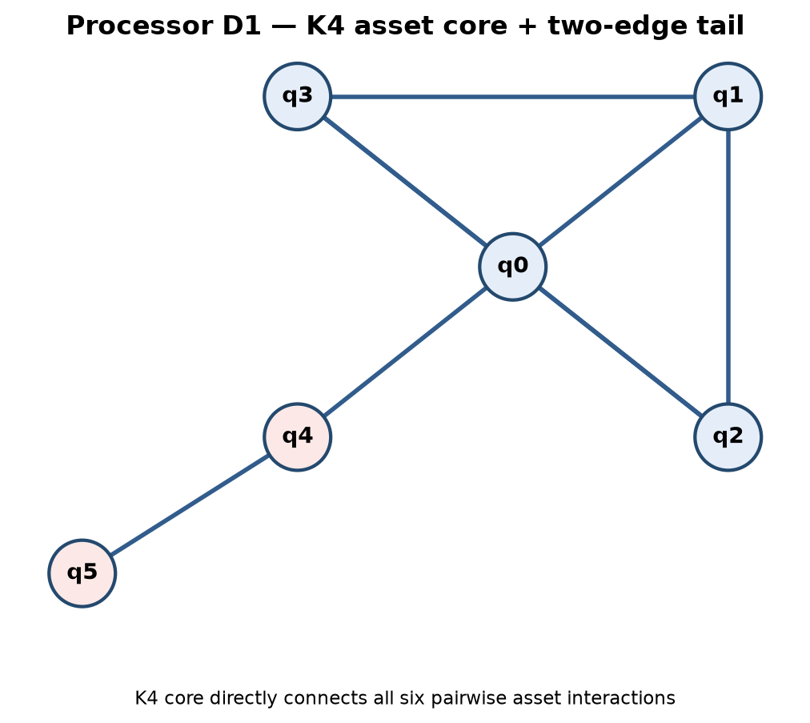
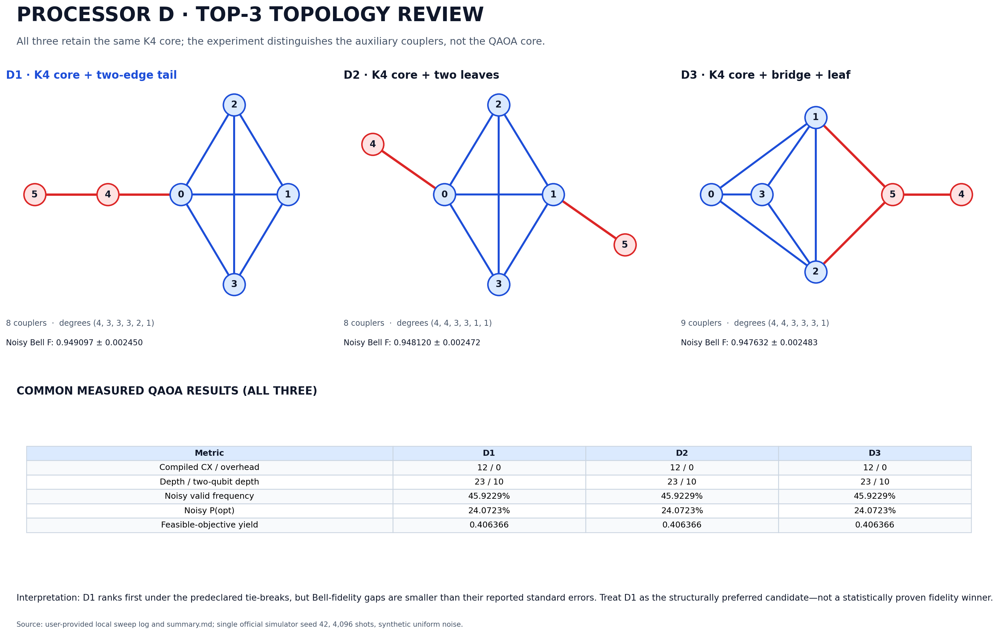
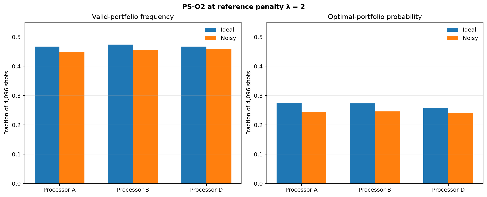
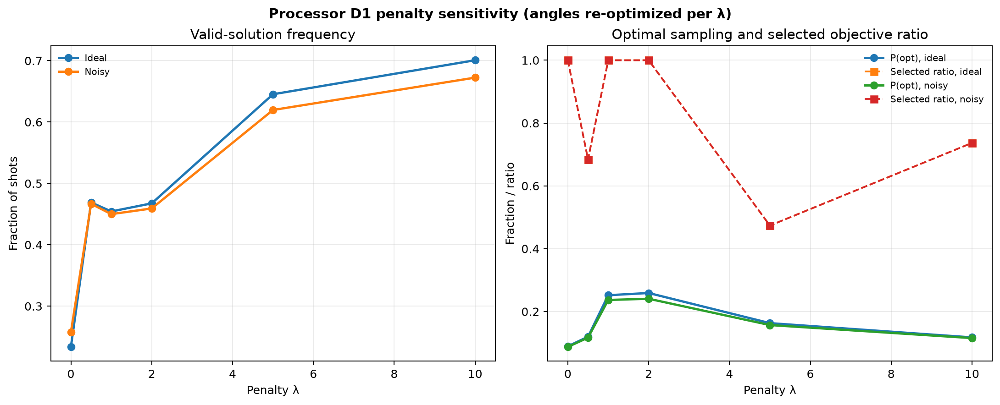

<table align="center" border="0" cellpadding="6">
  <tr>
    <td align="center" valign="middle" bgcolor="#F5F1E2">
      
    </td>
    <td align="center" valign="middle" bgcolor="#F5F1E2">
      
    </td>
  </tr>
</table>

<h1>QFF 2026 Phase 2 — PS-O2 Technical Report</h1>

QFF SRM AP 2026 · QUANTUM OPTIMIZATION · PHASE 2

<strong>PS-O2 · Constraint-Aware Portfolio Selection</strong>

<h2>✦ C O U G H I N G &nbsp; B A B Y ✦</h2>

TECHNICAL REPORT · SRM UNIVERSITY-AP × VIT-AP

  
  
  
  

---

## Executive summary

This project implements the locked Phase 2 PS-O2 portfolio-selection problem with a depth-one QAOA circuit. It preserves the organizer's shared benchmark helpers and source data, uses an exact classical reference for the four-variable instance, and evaluates reference-penalty runs on Processors A, B and selected Processor D1. It also performs the required Processor D penalty-sensitivity sweep and Bell-state verification.

Processor D1 is a six-qubit architecture: a complete four-qubit $K_4$ asset-interaction core plus a two-edge tail. D1 was selected from three benchmarked candidate topologies because it reached the same minimum measured QAOA resource footprint as D2, used one fewer coupler than D3, and ranked first under a predeclared deterministic rule. The observed Bell-fidelity differences between candidates were small and are not claimed to be statistically significant.

All reported final experiment values below are generated by `scripts/run_final_ps_o2.py` from saved CSV outputs. The four-variable problem is classically tractable by exhaustive enumeration; this work makes no quantum-advantage claim.

## 1. Problem statement and locked formulation

PS-O2 selects exactly two assets from four binary decision variables. The organizer-locked data are:

- Expected returns: $\mu=[5,3,4,2]$
- Risk-aversion coefficient: $q=0.5$
- Cardinality: $k=2$
- Penalty sweep: $\lambda\in\{0,0.5,1,2,5,10\}$
- Number of logical qubits: four, with logical qubit $i$ representing asset $i$.

The maximization objective is

$$
F(x)=\mu^T x-qx^T\Sigma x,\qquad x_i\in\{0,1\},\qquad \sum_i x_i=2.
$$

The symmetric risk matrix $\Sigma$ and all other numeric inputs are loaded from `data/instances.json`, the authoritative locked source. The QUBO formulation minimizes

$$
E_\lambda(x)=-F(x)+\lambda\left(\sum_i x_i-k\right)^2.
$$

The squared penalty discourages bitstrings that do not select exactly two assets. Its strength is a trade-off: too small a penalty can leave an invalid state as the global QUBO minimum; increasing it reinforces feasibility but changes the cost landscape optimized by QAOA. The QUBO minimum and the measured QAOA distribution are different objects; a valid exact ground state does not imply that every sampled bitstring is valid.

## 2. Exact classical reference and baseline

The exact reference enumerates all $2^4=16$ binary strings. Six strings satisfy the two-asset constraint. For every string it computes the return-risk objective, and it checks that direct penalty evaluation matches the QUBO matrix expression.

For the locked instance, the exact feasible optimum is $F^*=4.75$, with bitstring `1100` in $x_0,x_1,x_2,x_3$ order (assets 0 and 1). The uniform-random baseline follows by enumerating the state space:

- Valid-solution frequency: $6/16=0.375$.
- Optimal-portfolio probability: $1/16=0.0625$.
- Mean objective across the six feasible portfolios: $3.625$.
- Mean feasible objective divided by $F^*$: $3.625/4.75\approx0.76316$.

These are exact classical baselines, not QAOA measurements. The full six-portfolio table is saved in `results/tables/classical_solutions.csv`; the reference $\lambda=2$ matrix is saved in `results/tables/qubo_matrix_lambda_2.csv`.

## 3. QAOA circuit and optimization procedure

The implementation uses $p=1$, with one cost layer and one mixer layer. It initializes four qubits with Hadamard gates. The cost Hamiltonian is decomposed into single-qubit RZ rotations and pairwise CX–RZ–CX sequences derived from the symmetric QUBO matrix. The mixer uses RX rotations by $2\beta$ on every logical qubit. The implementation is in `src/qaoa_circuit.py`; the constant term in the Ising representation is omitted from the circuit because it contributes only a global phase, while the full QUBO constant is retained when calculating the expected objective energy.

For every required initialization seed $0,1,2,3,4$, the starting $\gamma$ and $\beta$ are drawn independently and uniformly from $[0,\pi]$ using `numpy.default_rng(seed)`. COBYLA optimizes exact Qiskit statevector expected QUBO energy with a maximum budget of 200 objective evaluations per start. The selected result minimizes the final exact expected QUBO energy; seed is the deterministic tie-break.

At the reference penalty $\lambda=2$, the selected ideal-optimized angles are reused for the required ideal and noisy runs on A, B and D. For the D penalty-sensitivity experiment, the angles are re-optimized separately for each required $\lambda$, again using the five prescribed seeds, then used for both ideal and noisy evaluation at that $\lambda$.

## 4. Benchmark protocol and reproducibility

The implementation uses the unmodified organizer module `qff_phase2.py` for the required settings:

| Setting | Value |
|---|---|
| Basis gates | `rz`, `sx`, `x`, `cx` |
| Transpiler optimization level | 1 |
| Transpiler seed | 42 |
| Aer simulator seed | 42 |
| Shots per condition | 4,096 |
| One-qubit depolarizing rate | 0.001 |
| CX depolarizing rate | 0.005 |
| Symmetric readout bit-flip probability | 0.01 |
| QAOA depth | $p=1$ |
| Initializations | Seeds 0–4 |
| Optimizer | COBYLA; at most 200 evaluations per start |

Processor A and B maps are the fixed reference graphs defined by the organizer. Processor D uses the selected six-qubit D1 graph and must pass the official `validate_processor_d()` rules. Before the benchmark, the runner verifies the SHA-256 hashes of `qff_phase2.py` and `data/instances.json`, checks that `data/instance.json` matches the official PS-O2 fields, and validates D1. The script fails rather than silently substituting altered benchmark inputs.

The results are deterministic for a fixed environment, helper version and seeds, subject to library/version details. The official noise model is uniform synthetic noise, not a device calibration model: it does not capture qubit-specific error rates, coupler calibration, drift or crosstalk.

## 5. Processor D design and candidate selection

### Selected topology

D1 uses six physical qubits and eight undirected couplers:

`[[0,1],[0,2],[0,3],[0,4],[1,2],[1,3],[2,3],[4,5]]`

Qubits 0–3 form a complete $K_4$ graph, so all six pairwise interactions between the four asset variables have direct physical connections. The tail `0–4–5` provides a distance-three farthest pair for the required Bell-state experiment. Maximum degree is four, the graph is connected, and the gate/noise declarations match the organizer's requirements.

### Why D1 over the alternatives

The candidate sweep compared D1 (K4 plus two-edge tail), D2 (K4 plus two leaves) and D3 (K4 plus bridge vertex and leaf). The following table records the measured candidate sweep that selected D1; the final runner regenerates A/B/D and D penalty results using the selected D1 configuration.

| Metric | D1: tail | D2: two leaves | D3: bridge + leaf |
|---|---:|---:|---:|
| Physical qubits | 6 | 6 | 6 |
| Couplers | 8 | 8 | 9 |
| Compiled CX | 12 | 12 | 12 |
| CX routing overhead | 0 | 0 | 0 |
| SWAPs | 0 | 0 | 0 |
| Circuit depth | 23 | 23 | 23 |
| Two-qubit depth | 10 | 10 | 10 |
| Noisy feasible-objective yield | 0.406366 | 0.406366 | 0.406366 |
| Noisy $P_{\mathrm{opt}}$ | 0.240723 | 0.240723 | 0.240723 |
| Noisy valid frequency | 0.459229 | 0.459229 | 0.459229 |
| Farthest-pair noisy Bell fidelity | 0.949097 ± 0.002450 | 0.948120 ± 0.002472 | 0.947632 ± 0.002483 |

D1 and D2 tie on all measured QAOA quality and resource metrics in the candidate run. D1 ranked first under the predeclared rule because its farthest-pair Bell-fidelity estimate was numerically the largest. The difference from D2 is about 0.00098, far below the combined reported standard error; it is not evidence of a statistically reliable fidelity advantage. D1 is retained because it reaches the measured resource minimum with eight couplers and has a less concentrated degree distribution than the two-leaf design. D3 uses an extra coupler without an observed improvement in the benchmark.

### Expected benefit and trade-off

The four-qubit logical cost circuit has interactions between every pair of assets. A direct K4 physical core removes the need to route these interactions through a sparse logical-core coupling graph. In the candidate sweep, D used 12 compiled CX gates for 12 logical CX gates, with zero routing overhead and zero SWAPs; the compiled circuit depth was 23 versus 42 on A and 34 on B. The current project runner re-measures these metrics and writes them to `results/tables/processor_resources.csv`.

The trade-off is additional physical qubits and couplers relative to the reference devices, plus a degree-four core vertex. Higher connectivity can create more crosstalk exposure on real hardware, which the uniform synthetic noise model does not represent. The tail improves the diameter for an informative Bell test, but it does not automatically improve the four-logical-qubit QAOA distribution.

## 6. Generated benchmark results

<!-- BEGIN GENERATED RESULTS -->

### Six feasible portfolios and objective values

| Portfolio x0…x3 | Selected assets | Asset count | F(x) |
| --- | --- | --- | --- |
| 1100 | 0, 1 | 2 | 4.7500 |
| 0110 | 1, 2 | 2 | 4.0000 |
| 1001 | 0, 3 | 2 | 4.0000 |
| 0101 | 1, 3 | 2 | 3.5000 |
| 0011 | 2, 3 | 2 | 3.2500 |
| 1010 | 0, 2 | 2 | 2.2500 |

### QUBO matrix at λ = 2

Rows and columns use asset order x0…x3. The constant offset is retained by the classical reference helper; the matrix is saved in `results/tables/qubo_matrix_lambda_2.csv`.

| Row | x0 | x1 | x2 | x3 |
| --- | --- | --- | --- | --- |
| x0 | -9.0000 | 2.2500 | 3.5000 | 2.2500 |
| x1 | 2.2500 | -8.2500 | 2.2500 | 2.1250 |
| x2 | 3.5000 | 2.2500 | -8.2500 | 2.2500 |
| x3 | 2.2500 | 2.1250 | 2.2500 | -7.5000 |

### Processor A/B/D at λ = 2

| Processor | Condition | Selected | Selected F | F* | Objective ratio | Valid frequency | P(opt) | Random valid | Random P(opt) | Random objective ratio |
| --- | --- | --- | --- | --- | --- | --- | --- | --- | --- | --- |
| Processor A | ideal | 1100 | 4.7500 | 4.7500 | 1.0000 | 0.4673 | 0.2739 | 0.3750 | 0.0625 | 0.7632 |
| Processor A | noisy | 1100 | 4.7500 | 4.7500 | 1.0000 | 0.4487 | 0.2439 | 0.3750 | 0.0625 | 0.7632 |
| Processor B | ideal | 1100 | 4.7500 | 4.7500 | 1.0000 | 0.4739 | 0.2734 | 0.3750 | 0.0625 | 0.7632 |
| Processor B | noisy | 1100 | 4.7500 | 4.7500 | 1.0000 | 0.4556 | 0.2461 | 0.3750 | 0.0625 | 0.7632 |
| Processor D | ideal | 1100 | 4.7500 | 4.7500 | 1.0000 | 0.4675 | 0.2590 | 0.3750 | 0.0625 | 0.7632 |
| Processor D | noisy | 1100 | 4.7500 | 4.7500 | 1.0000 | 0.4592 | 0.2407 | 0.3750 | 0.0625 | 0.7632 |

### Compiled resource comparison

| Processor | Logical qubits | Physical qubits | Logical CX | Compiled CX | Depth | Two-qubit depth | SWAPs | CX overhead |
| --- | --- | --- | --- | --- | --- | --- | --- | --- |
| Processor A | 4 | 5 | 12 | 18 | 42 | 18 | 2 | 6 |
| Processor B | 4 | 9 | 12 | 15 | 34 | 15 | 1 | 3 |
| Processor D | 4 | 6 | 12 | 12 | 23 | 10 | 0 | 0 |

### Processor D Bell-state verification

| Pair | Physical qubits | Condition | Distance | XX | YY | ZZ | Fidelity | Fidelity SE |
| --- | --- | --- | --- | --- | --- | --- | --- | --- |
| adjacent | [0, 1] | ideal | 1 | 1.0000 | -1.0000 | 1.0000 | 1.0000 | 0.0000 |
| adjacent | [0, 1] | noisy | 1 | 0.9458 | -0.9521 | 0.9551 | 0.9633 | 0.0021 |
| farthest | [1, 5] | ideal | 3 | 1.0000 | -1.0000 | 1.0000 | 1.0000 | 0.0000 |
| farthest | [1, 5] | noisy | 3 | 0.9341 | -0.9219 | 0.9404 | 0.9491 | 0.0024 |

### Processor D penalty sensitivity (angles re-optimized for each λ)

| λ | Condition | QUBO minimum valid | Valid frequency | P(opt) | Selected | Objective ratio | Seed | γ | β |
| --- | --- | --- | --- | --- | --- | --- | --- | --- | --- |
| 0.0000 | ideal | False | 0.2336 | 0.0894 | 1100 | 1.0000 | 3 | 0.7890 | 2.6644 |
| 0.0000 | noisy | False | 0.2576 | 0.0874 | 1100 | 1.0000 | 3 | 0.7890 | 2.6644 |
| 0.5000 | ideal | False | 0.4690 | 0.1199 | 0011 | 0.6842 | 0 | 3.1416 | 2.3350 |
| 0.5000 | noisy | False | 0.4668 | 0.1169 | 0011 | 0.6842 | 0 | 3.1416 | 2.3350 |
| 1.0000 | ideal | True | 0.4543 | 0.2520 | 1100 | 1.0000 | 4 | 3.0608 | 2.4206 |
| 1.0000 | noisy | True | 0.4500 | 0.2368 | 1100 | 1.0000 | 4 | 3.0608 | 2.4206 |
| 2.0000 | ideal | True | 0.4675 | 0.2590 | 1100 | 1.0000 | 0 | 3.1082 | 0.6998 |
| 2.0000 | noisy | True | 0.4592 | 0.2407 | 1100 | 1.0000 | 0 | 3.1082 | 0.6998 |
| 5.0000 | ideal | True | 0.6453 | 0.1631 | 1010 | 0.4737 | 1 | 1.9073 | 2.6541 |
| 5.0000 | noisy | True | 0.6196 | 0.1570 | 1010 | 0.4737 | 1 | 1.9073 | 2.6541 |
| 10.0000 | ideal | True | 0.7007 | 0.1177 | 0101 | 0.7368 | 3 | 0.2519 | 1.2951 |
| 10.0000 | noisy | True | 0.6724 | 0.1155 | 0101 | 0.7368 | 3 | 0.2519 | 1.2951 |

<!-- END GENERATED RESULTS -->

## 7. Interpretation

The key resource result from candidate selection is the compiled CX reduction to the 12-CX logical lower count, with no routing SWAPs and depth 23. The portfolio-quality result must be read separately: under the one-seed official simulation protocol, D1's valid-solution frequency was similar to or slightly higher than A/B, while its optimal-portfolio probability was not better than every reference processor. The selected architecture is therefore justified most strongly by measured connectivity/resource behavior, not by a claim that it consistently increases $P_{\mathrm{opt}}$.

The D Bell experiment evaluates both one physically adjacent pair and a graph-farthest pair. Ideal simulations should recover the target Bell correlations; under the official noise model the observed fidelity decreases, and the distant-pair experiment includes additional routing/exposure associated with connecting separated physical qubits. Bell fidelity measures a circuit primitive and is not interchangeable with portfolio objective quality.

The penalty sweep studies whether exact QUBO ground-state feasibility corresponds to the measured sampling distribution. At low $\lambda$, the exact QUBO minimum may be infeasible. At higher penalties, exact feasibility can be restored, but QAOA at $p=1$ still has finite probability mass on invalid bitstrings. The full curve and table must be interpreted together: no single penalty setting alone guarantees the highest value on every sampling metric.

## 8. Outputs and artifact map

| Artifact | Purpose |
|---|---|
| `results/tables/results.csv` | Organizer-schema processor/condition result rows, with an additional `lambda` column for PS-O2 sweep rows |
| `results/tables/bell.csv` | D adjacent/farthest Bell measurements in ideal/noisy conditions |
| `results/tables/processor_conditions.csv` | Detailed selected-portfolio and validity metrics for A/B/D at $\lambda=2$ |
| `results/tables/processor_resources.csv` | Official compiled-circuit resource metrics |
| `results/tables/processor_d_lambda_sweep.csv` | D penalty sweep in ideal/noisy conditions |
| `results/tables/lambda_optimization_trials.csv` | Five COBYLA starts for each $\lambda$, including angle and evaluation metadata |
| `results/tables/classical_solutions.csv` | Exact feasible portfolios and objective scores |
| `results/tables/qubo_matrix_lambda_2.csv` | Reference QUBO matrix |
| `results/figures/processor_comparison_ps_o2.png` | A/B/D quality comparison |
| `results/figures/processor_d_topology.png` | D1 coupling graph |
| `results/figures/processor_d_lambda_sweep.png` | D penalty sensitivity |
| `results/evidence/processor_d_sweep/` | Candidate-sweep evidence archived from the temporary comparison |
| `results/run_metadata_final.json` | Seeds, selected angles, versions and locked-file hashes |

## 9. Limitations and next improvements

1. **Finite shots:** reported frequencies have finite-sample uncertainty. The official protocol uses 4,096 shots, so small cross-processor differences should not be overinterpreted.
2. **Synthetic noise:** uniform depolarizing and readout errors do not model a calibrated device's connectivity-specific noise or crosstalk.
3. **Small instance:** all 16 states can be enumerated exactly; no quantum advantage is claimed.
4. **Single p value:** this required comparison uses $p=1$; greater depth would alter both the gate budget and noise exposure and should be reported as a separate experiment.
5. **Single official seed:** the required seed is preserved for comparability. More simulator seeds could be added as clearly labelled robustness experiments, but must not replace the official result.

The most defensible next improvement is repeated-seed or bootstrap analysis of the small A/B/D quality differences and, if physical calibration data become available, a device-informed noise model as a separately labelled additional experiment.

## 10. AI-use disclosure

AI assistance was used for planning, architecture enumeration and ranking, mathematical review, code drafting, notebook/report development, and test design. The team remains responsible for the experiment, its interpretation, and the correctness of the submitted repository.
